# MONDAY LEAGUE

## Guida del capitano

Questa guida descrive il comportamento reale dell'app MOVI verificato il 8 ottobre 2026 sul checkout `93310bad42600f065b7317c12879f8f52ee5a972`, con Supabase locale su `127.0.0.1:55421` e applicazione su `http://127.0.0.1:3101`.

Le etichette riportate sono quelle visibili nell'interfaccia. Le schermate usano esclusivamente account e dati sintetici locali.

## 1. Il ruolo del capitano

Il capitano è il giocatore indicato in `league_teams.captain_player_id`. Il sistema concede i comandi riservati solo quando quel giocatore è attivo nella rosa e il suo `league_team_players.user_id` coincide con l'utente MOVI autenticato.

La pagina squadra mostra quindi la sezione **Area capitano — Gestisci la tua squadra** solo al capitano corretto. Un giocatore normale vede squadra, rosa, calendario, risultati e classifica, ma non vede i comandi di gestione.

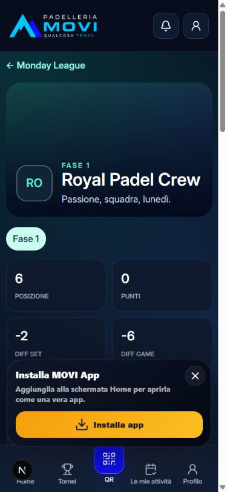

## 2. Come entrare nella Monday League

1. Accedi a MOVI con il tuo profilo pubblico.
2. Nella Home individua il banner **Monday League**.
3. Tocca **Apri Monday League**.
4. Nella pagina della competizione scegli una delle viste:
   - **Classifica**;
   - **Calendario / Risultati**;
   - **Squadre**.
5. In **Squadre**, apri la tua squadra.

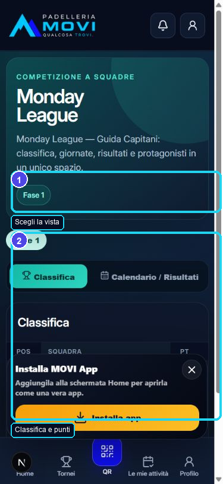

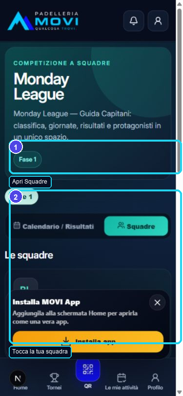

Route verificate:

- `/` — ingresso Home;
- `/monday-league` — classifica, calendario/risultati e squadre;
- `/monday-league/squadre/[slug]?phase=[phase-id]` — profilo squadra e comandi capitano.

Non esiste una pagina partita separata: i dati e i comandi della partita selezionata dal sistema compaiono nella pagina della squadra.

## 3. La pagina della tua squadra

La testata mostra:

- logo o iniziali della squadra;
- fase corrente;
- nome e slogan;
- posizione, punti, differenza set e differenza game.

Più sotto trovi:

- **Area capitano**, se sei il capitano autenticato;
- **Rosa**;
- **Prossima partita**;
- **Prossime giornate**;
- **Risultati**;
- formazioni ufficiali quando sono pubbliche.

La riga partita riporta data, ora, sede, squadre, punteggio e stato. Toccando un risultato si aprono i dettagli dei set quando disponibili.

## 4. Personalizzare la squadra

### Funzioni disponibili

Il capitano può:

- modificare lo **Slogan**;
- caricare o sostituire il **Logo**;
- caricare o sostituire l'**Immagine squadra**.

Procedura slogan:

1. Apri la tua squadra.
2. In **Modifica profilo squadra**, modifica il campo **Slogan**.
3. Tocca **Salva profilo**.
4. Attendi il messaggio **Profilo aggiornato**.

Procedura immagini:

1. Tocca **Logo** oppure **Immagine squadra**.
2. Scegli un file PNG, JPEG o WebP.
3. Attendi il messaggio **Immagine aggiornata**.

Limiti verificati dal codice:

- logo: massimo 2 MB;
- immagine squadra: massimo 5 MB.

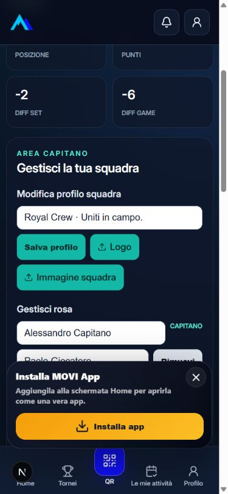

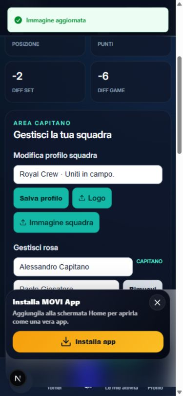

### Funzioni non disponibili al capitano

Il capitano non può cambiare:

- nome squadra;
- colori;
- slug;
- capitano assegnato;
- ruoli o ordine dei giocatori.

Queste operazioni non compaiono nell'Area capitano; il nome squadra resta una funzione organizzativa/Admin.

## 5. Gestire la rosa

La gestione rosa è disponibile solo prima dell'inizio ufficiale della competizione: stagione in `draft` e Fase 1 in `draft`.

Procedura reale:

1. In **Gestisci rosa**, il capitano resta fisso e non è rimovibile.
2. Tocca **Rimuovi** accanto a un giocatore per escluderlo dalla rosa proposta.
3. Tocca **Aggiungi giocatore** per creare un nuovo campo.
4. Inserisci il nome del giocatore.
5. Tocca **Salva rosa**.
6. Attendi **Rosa aggiornata**.

La rosa può contenere da 1 a 4 giocatori e deve sempre conservare il capitano. Un campo vuoto produce il messaggio **Nome giocatore obbligatorio**.

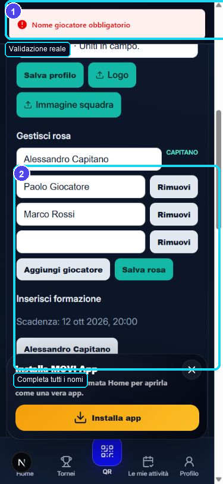

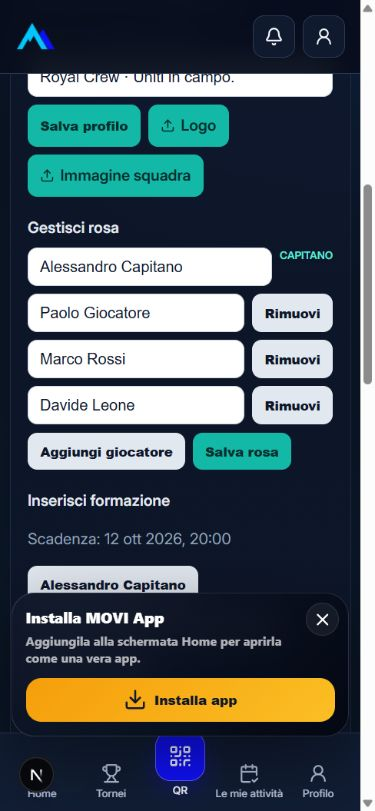

Quando la stagione è iniziata, l'editor viene sostituito da:

> Rosa ufficiale — per modifiche contatta l'organizzazione

Non sono implementati inviti, disponibilità, riserve, ruoli, ordine di gioco o trasferimento del ruolo di capitano.

## 6. Calendario e partita selezionata

La pagina squadra espone la **Prossima partita** con:

- avversario;
- casa/trasferta;
- giorno e ora;
- sede;
- stato.

La sezione capitano lavora sulla prima partita rilevante della fase corrente secondo lo stato sportivo. Non esiste il comando **Apri partita** né una route di dettaglio dedicata.

## 7. Preparare lo schieramento

Lo schieramento è disponibile quando:

- la partita ha data e ora;
- non è stato applicato un blocco manuale;
- manca più di un'ora all'inizio;
- l'utente è il capitano della squadra.

Procedura:

1. Apri la tua squadra.
2. Vai a **Inserisci formazione**.
3. Controlla la riga **Scadenza**.
4. Seleziona esattamente due giocatori attivi della rosa.
5. Tocca **Conferma i 2 giocatori**.
6. Attendi **Formazione inviata**.

Con un solo giocatore il pulsante resta disabilitato. Lo stesso giocatore non può occupare entrambi i posti.

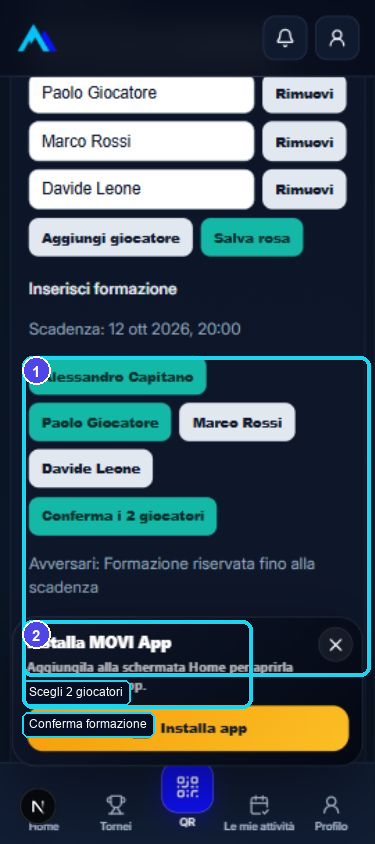

Lo schieramento già inviato può essere sostituito prima della scadenza: ogni nuovo invio crea una revisione e rende precedente la formazione superata.

## 8. Visibilità e blocco dello schieramento

Prima della scadenza compare:

> Avversari: Formazione riservata fino alla scadenza

La formazione avversaria diventa visibile dopo il blocco o alla scadenza. Un'ora prima della partita l'editor viene sostituito da:

> Formazione bloccata

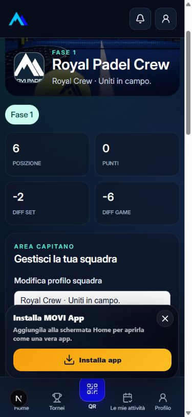

Non sono implementati ordine dei giocatori, coppie multiple, riserve o sostituzioni nel flusso capitano.

## 9. Inserire il risultato

Solo il capitano della squadra di casa può inserire il risultato, e solo dopo l'orario di inizio della partita.

Procedura:

1. Apri la pagina della squadra di casa dopo l'inizio.
2. Vai a **Risultato partita**.
3. Compila i game del **Set 1** e del **Set 2**.
4. Compila il terzo set solo se giocato.
5. Verifica l'anteprima `2–0` oppure `2–1`.
6. Tocca **Inserisci risultato**.
7. Conferma il dialogo che ricorda che il risultato non sarà modificabile.

Il form accetta esclusivamente un risultato legale 2–0 o 2–1. Con un solo set compare:

> Inserisci un risultato legale 2–0 o 2–1

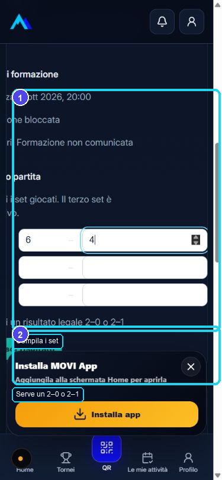

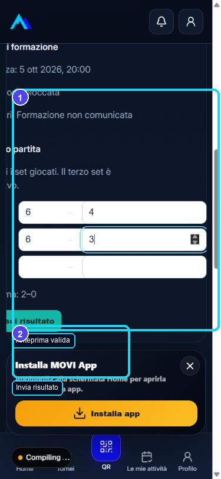

Dopo l'invio lo stato è **Provvisorio** e la UI indica **Risultato inviato · Non modificabile**. Il capitano non può correggerlo: una correzione richiede l'Admin.

## 10. Confermare un risultato

Non è implementato un pulsante con cui il capitano ospite conferma esplicitamente il risultato.

Il comportamento reale è:

- l'ospite può contestare entro 48 ore;
- se non contesta, lo stato effettivo diventa automaticamente **Definitivo** alla scadenza;
- l'Admin può confermare prima o risolvere un'eventuale contestazione.

## 11. Contestare un risultato

Solo il capitano della squadra ospite può contestare un risultato inviato dal capitano di casa.

Procedura:

1. Apri la tua squadra entro 48 ore dall'invio.
2. In **Risultato partita**, controlla punteggio e **Termine contestazione**.
3. Inserisci una **Motivazione obbligatoria**.
4. Tocca **Contesta risultato**.
5. Conferma il dialogo.
6. Attendi **Contestazione inviata**.

La motivazione non può essere vuota e può contenere al massimo 1000 caratteri.

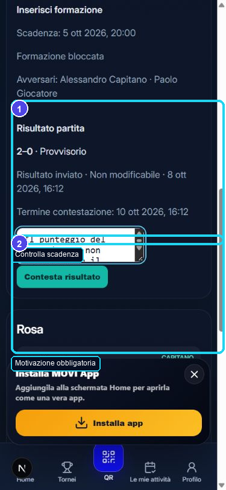

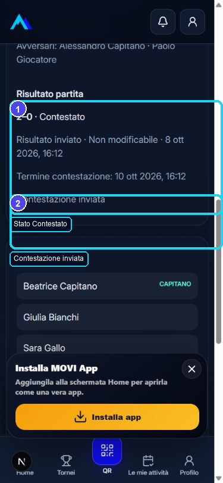

Non esiste caricamento di prove o allegati.

## 12. Cosa succede dopo una contestazione

Lo stato della partita diventa **Contestato**. La motivazione viene mostrata all'Admin nella pagina **Risultati Monday League**, filtro **CONTESTATI**.

L'Admin può:

- **Respingi contestazione**, confermando il risultato;
- **Accogli e correggi**, registrando una nuova revisione corretta.

Il capitano non può risolvere la contestazione e non esiste un flusso di risposta tra capitani.

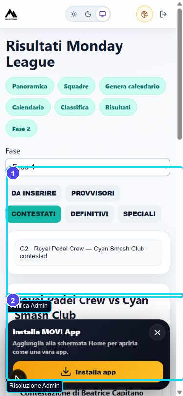

Dopo la risoluzione, il capitano riceve una comunicazione in-app. Nel test reale il pannello **Notifiche** ha mostrato:

> Contestazione risolta

con CTA **Apri** verso la squadra.

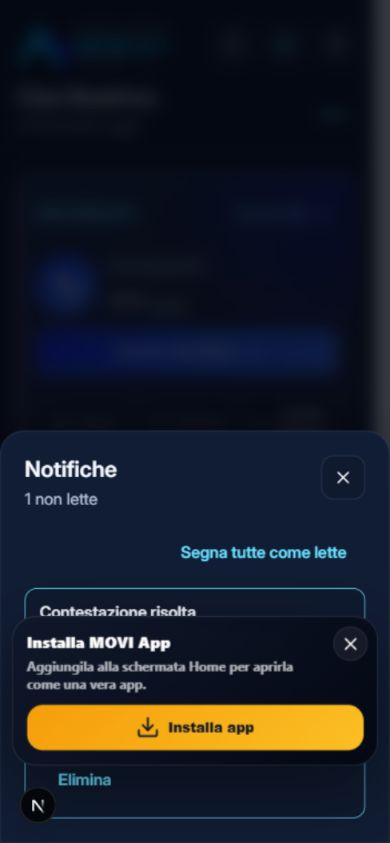

## 13. Risultato definitivo

Un risultato è **Definitivo** quando:

- sono trascorse 48 ore senza contestazione;
- l'Admin ha confermato il risultato;
- l'Admin ha risolto la contestazione.

Il risultato definitivo contribuisce alla classifica. Anche risultati provvisori e contestati sono inclusi dal modello di classifica corrente e contrassegnati internamente come provvisori.

## 14. Classifica e storico

La vista **Classifica** mostra:

- posizione;
- squadra;
- partite giocate;
- punti;
- differenza set;
- differenza game.

L'ordinamento applica: punti, differenza set, differenza game e ordine di spareggio della fase.

La vista **Calendario / Risultati** raggruppa le partite per giornata. La pagina squadra separa **Prossime giornate** e **Risultati** e consente di espandere un risultato per vedere i set.

## 15. Scadenze e blocchi

| Evento | Regola reale |
|---|---|
| Modifica rosa | Solo stagione `draft` e Fase 1 `draft` |
| Invio/modifica formazione | Fino a 1 ora prima di `scheduled_at` |
| Visibilità formazione avversaria | Dal blocco o dalla scadenza formazione |
| Inserimento risultato | Dopo `scheduled_at`, solo capitano di casa |
| Modifica risultato capitano | Non consentita dopo l'invio |
| Contestazione | Entro 48 ore da `submitted_at`, solo capitano ospite |
| Conferma senza contestazione | Effettiva automaticamente dopo 48 ore |
| Risoluzione contestazione | Solo Admin |

## 16. Capitano e giocatore normale

| Azione | Capitano | Giocatore normale |
|---|---:|---:|
| Vedere competizione e classifica | Sì | Sì |
| Vedere squadra, rosa e risultati | Sì | Sì |
| Modificare slogan | Sì | No |
| Caricare logo/immagine squadra | Sì | No |
| Cambiare nome squadra | No | No |
| Gestire rosa nel periodo ammesso | Sì | No |
| Inviare/modificare formazione entro la scadenza | Sì | No |
| Inserire risultato come squadra di casa | Sì | No |
| Modificare un risultato già inviato | No | No |
| Confermare esplicitamente il risultato ospite | Non implementato | No |
| Contestare come squadra ospite entro 48 ore | Sì | No |
| Risolvere una contestazione | No, solo Admin | No |

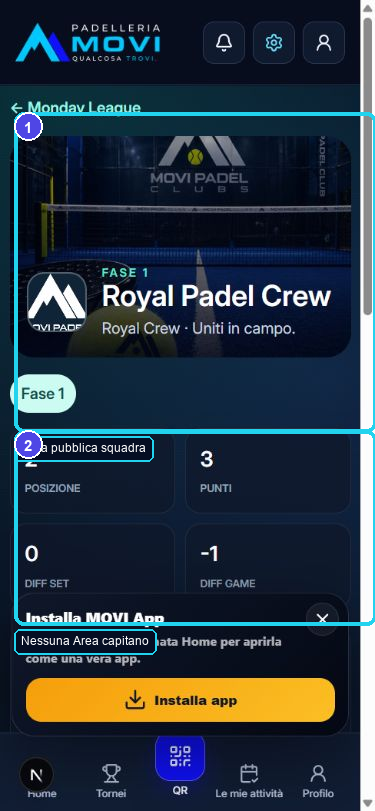

## 17. Notifiche e Le mie attività

Il sistema Monday League crea eventi per promemoria, variazioni calendario, risultato inviato, contestazione aperta e contestazione risolta. Il worker locale li trasforma in comunicazioni visibili nel pannello **Notifiche**.

Nel comportamento corrente, **Le mie attività** non include partite o azioni Monday League. L'ingresso operativo resta il banner Home e la pagina `/monday-league`.

Non è stata individuata una UI capitano specifica per email Monday League; le preferenze email generali dell'utente sono separate.

## 18. Problemi più comuni

### “Nome giocatore obbligatorio”

Un campo della rosa è vuoto. Inserisci il nome o rimuovi la riga, poi salva di nuovo.

### “Rosa ufficiale — per modifiche contatta l'organizzazione”

La competizione è già iniziata. Le modifiche non sono più disponibili al capitano.

### “Conferma i 2 giocatori” è disabilitato

Devi selezionare esattamente due giocatori attivi.

### “Formazione bloccata”

È trascorsa la scadenza di un'ora prima della partita oppure l'organizzazione ha bloccato le formazioni.

### “Inserisci un risultato legale 2–0 o 2–1”

Completa due o tre set con un vincitore valido.

### Non vedo “Contesta risultato”

Controlla che tu sia il capitano ospite, che il risultato sia ancora provvisorio e che non siano trascorse 48 ore.

### Il risultato è già definitivo

La finestra di contestazione è scaduta oppure l'Admin ha già risolto il caso.

## 19. Checklist prima della partita

- [ ] Controlla avversario, data, ora e sede.
- [ ] Verifica che la rosa sia corretta prima dell'avvio della stagione.
- [ ] Seleziona esattamente due giocatori.
- [ ] Tocca **Conferma i 2 giocatori** prima della scadenza.
- [ ] Verifica il messaggio **Formazione inviata**.

## 20. Checklist dopo la partita

### Capitano di casa

- [ ] Inserisci tutti i set giocati.
- [ ] Controlla l'anteprima 2–0 o 2–1.
- [ ] Conferma solo dopo aver verificato il punteggio.
- [ ] Ricorda: dopo l'invio non puoi modificarlo.

### Capitano ospite

- [ ] Controlla il risultato provvisorio.
- [ ] Se è corretto, non serve alcuna azione.
- [ ] Se è errato, inserisci la motivazione e tocca **Contesta risultato** entro 48 ore.
- [ ] Controlla la notifica di risoluzione.

## 21. Tracciabilità tecnica

| Flusso | Route/componente | API | Regola/tabelle |
|---|---|---|---|
| Vista lega | `/monday-league`, `PublicLeagueViews.tsx` | `GET /api/monday-league` | `league_seasons`, `league_phases`, `league_matches`, `league_get_standings` |
| Vista squadra | `/monday-league/squadre/[slug]` | `GET /api/monday-league/teams/[slug]` | `public-read-model.ts`, `league_get_captain_context` |
| Ruolo capitano | `CaptainControls` | incluso nel GET squadra | `league_is_captain(user_id, team_id)` |
| Profilo squadra | `CaptainControls` | `PATCH /api/monday-league/teams/[slug]/profile` | `league_captain_update_team_profile` |
| Media squadra | `CaptainControls` | `POST /api/monday-league/teams/[slug]/media` | `league_is_captain`, Storage locale |
| Rosa | `CaptainControls` | `PUT /api/monday-league/teams/[slug]/roster` | `league_captain_replace_roster_preseason` |
| Formazione | `CaptainControls` | `POST /api/monday-league/matches/[matchId]/lineups` | `league_write_lineup`, `league_lineups`, `league_lineup_players` |
| Risultato | `CaptainControls` | `POST /api/monday-league/matches/[matchId]/result` | `league_captain_submit_result`, `league_result_submissions`, `league_match_sets` |
| Contestazione | `CaptainControls` | `POST /api/monday-league/matches/[matchId]/contest` | `league_away_captain_contest_result`, `league_result_contests` |
| Risoluzione | `/admin/monday-league/risultati` | comando Admin risultati | `league_admin_resolve_contest` |
| Notifiche | pannello globale Notifiche | worker Monday League | `league_notification_events`, `league_deliver_notification_event`, `communications` |

Le regole principali derivano dalle migrazioni:

- `20260920210000_monday_league_stage5_captain_lineups.sql`;
- `20260921090000_monday_league_stage6_results_contests.sql`;
- `20260921130000_monday_league_stage7_notifications.sql`;
- `20260925100000_monday_league_prerelease_h3_captain_context.sql`.
